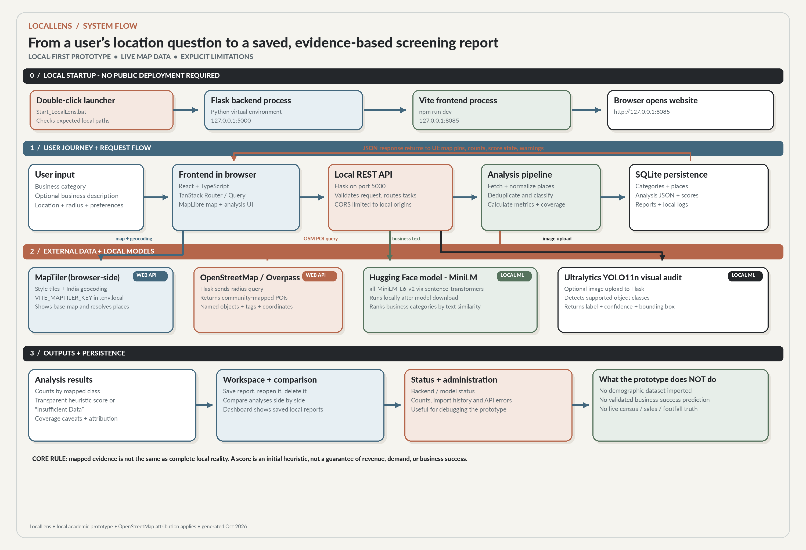

# LocalLens

**Business Location Intelligence & Decision-Support Platform**

LocalLens is a locally run web application that helps users conduct preliminary research on potential business locations. A user selects a business category, chooses a point on the map and a search radius, and receives a summary of mapped category matches, nearby amenities and public-transport points. Users can save analyses, compare locations and revisit reports.

> **Important:** LocalLens is an academic prototype. Its location score is a transparent, rule-based screening aid—not a prediction of commercial success, revenue, customer demand or profitability. OpenStreetMap records may be incomplete or outdated. Demographic suitability is not currently included because a suitable demographic dataset has not been imported.

## Features

- Interactive map and location selection using MapLibre GL JS and MapTiler.
- Geographic point-of-interest retrieval from OpenStreetMap through the Overpass API.
- Business-category matching, amenity and transport summaries within supported search radii.
- Weighted, rule-based preliminary location screening score with coverage indicators.
- Save, retrieve and delete reports; compare multiple analysed locations.
- SQLite persistence for business categories, places, analyses, reports and operational logs.
- Optional semantic business-category suggestions with `sentence-transformers/all-MiniLM-L6-v2`.
- Optional image object detection with Ultralytics YOLO11n.

## System overview



1. The React frontend collects the selected business type, location, radius and preferences.
2. It calls the Flask backend through REST endpoints.
3. Flask validates the request and queries Overpass for mapped OpenStreetMap features.
4. The backend filters and classifies returned records, calculates the prototype score, and stores relevant records and analysis results in SQLite.
5. The API returns the analysis to the frontend for display, mapping, saving and comparison.
6. Optional local ML endpoints provide category suggestions and object detections from an uploaded image.

## Technology stack

| Layer | Technology | Role |
|---|---|---|
| Frontend | React, TypeScript, TanStack Start, Vite | Pages, forms, navigation and results |
| Mapping | MapLibre GL JS, MapTiler | Interactive map rendering and map styles |
| Backend | Python, Flask, Flask-CORS | REST API, validation, geographic processing and scoring |
| Geographic data | OpenStreetMap, Overpass API | Mapped businesses, amenities and transport-related features |
| Database | SQLite | Categories, places, analyses, reports and logs |
| NLP (optional) | Hugging Face Sentence Transformers | Semantic business-category suggestions |
| Computer vision (optional) | Ultralytics YOLO11n | Object detection in uploaded site photographs |

## Project structure

```text
LocalLens/
├── main.py                      # Flask REST API and analysis logic
├── schema.sql                   # SQLite table definitions
├── init_db.py                   # Creates tables and initial business categories
├── requirements.txt             # Core Python dependencies
├── requirements-ml.txt          # Optional ML dependencies
├── .env.example                 # Optional backend configuration template
├── .gitignore
├── docs/
│   └── architecture-flowchart.png
└── frontend/
    ├── package.json
    ├── vite.config.ts
    ├── .env.local.example
    ├── public/
    └── src/
        ├── components/
        ├── config/
        ├── lib/
        └── routes/
```

## Getting started (Windows PowerShell)

### 1. Prerequisites

- Python 3.10 or later.
- Node.js and npm (the project was developed with Node.js 24 and npm 11).
- A MapTiler API key for the map style/tiles.
- An internet connection for live Overpass requests and map tiles.

### 2. Set up the Python backend

Run these commands from the repository root:

```powershell
python -m venv .venv
.\.venv\Scripts\Activate.ps1
python -m pip install --upgrade pip
pip install -r requirements.txt
```

Create the SQLite database and seed its business categories:

```powershell
python init_db.py
```

This creates `locallens.db` locally. The database is intentionally excluded from Git; each clone creates its own database using the schema and initialisation script.

Optional machine-learning features can be installed separately:

```powershell
pip install -r requirements-ml.txt
```

The first use of the Hugging Face or YOLO model may download model files into the local model cache. Model downloads can be large. These model weights are not stored in this repository.

### 3. Configure the backend (optional)

Copy `.env.example` to `.env` in the repository root if you want to override the default Overpass endpoint. The backend defaults to the public Overpass interpreter URL when `OVERPASS_URL` is not set.

### 4. Configure the frontend

Open a second terminal and move into the frontend folder:

```powershell
cd frontend
Copy-Item .env.local.example .env.local
notepad .env.local
```

Set your MapTiler key and leave the local API URL as shown:

```env
VITE_MAPTILER_KEY=YOUR_MAPTILER_KEY
VITE_API_BASE_URL=http://127.0.0.1:5000
```

Do not commit `.env.local`. The MapTiler browser key is used by the frontend and is visible to browsers; restrict it in MapTiler Cloud to the local origins you use, such as `http://127.0.0.1:8085` and `http://localhost:8085`.

Install frontend dependencies:

```powershell
npm install
```

### 5. Run the application

**Terminal 1 — backend**, from the repository root:

```powershell
.\.venv\Scripts\Activate.ps1
python main.py
```

The Flask development server listens at `http://127.0.0.1:5000`.

**Terminal 2 — frontend**, from `frontend/`:

```powershell
npm run dev
```

Open `http://127.0.0.1:8085` in your browser.

Keep both terminal windows open while using the application. This is a local academic development setup, not a production deployment configuration.

## REST API overview

The Flask application currently exposes these routes:

| Method | Endpoint | Purpose |
|---|---|---|
| GET | `/api/health` | Backend health check |
| GET | `/api/categories` | Active business categories |
| GET | `/api/places` | Retrieve mapped places around coordinates and radius |
| POST | `/api/analyze` | Run geographic analysis and calculate screening score |
| GET | `/api/reports` | List saved reports |
| GET | `/api/reports/<report_id>` | Retrieve one report |
| POST | `/api/reports` | Save an analysis or comparison report |
| DELETE | `/api/reports/<report_id>` | Delete a saved report |
| POST | `/api/compare` | Compare submitted analyses |
| GET | `/api/dashboard` | Dashboard summary data |
| GET | `/api/status` | Configured provider and model status |
| GET | `/api/admin/summary` | Administrative summary counts |
| GET | `/api/admin/imports` | Data import log |
| GET | `/api/admin/errors` | API error log |
| POST | `/api/interpret-business` | Optional semantic category suggestions |
| POST | `/api/visual-audit` | Optional YOLO image object detection |

For implementation details, see the route handlers and request/response structures in `main.py`, along with the corresponding TypeScript API client and types under `frontend/src/lib/api/`.

## Database

`schema.sql` defines these tables:

- `business_categories`: supported business categories and groups.
- `places`: geographic records, source identifiers, categories and coordinates.
- `analyses`: saved analysis inputs, result JSON, score and coverage.
- `reports`: saved analysis or comparison reports.
- `data_import_logs`: dataset import activity.
- `api_logs`: endpoint status and error messages.

## Scoring and data limitations

- The score is based on the available mapped indicators and configured prototype rules.
- The competition component is a preference-based heuristic. It is not the raw count of competitors; the mapped category-match count is reported separately.
- Amenities and transport scores are capped prototype indicators, not validated measures of demand, service quality or actual accessibility.
- Straight-line distances are not walking or driving distances.
- Demographic suitability is unavailable until a suitable official dataset is added.
- Zero mapped matches means the query returned none; it does not prove that no businesses exist in the real world.
- Public Overpass infrastructure can be slow, rate-limited or temporarily unavailable.
- YOLO detections from one photograph cannot establish typical footfall or customer demand.

## Data attribution

Geographic features are retrieved from OpenStreetMap via Overpass. OpenStreetMap attribution is displayed in the application. See [OpenStreetMap copyright and licence information](https://www.openstreetmap.org/copyright). Map tiles/styles are provided by MapTiler and are subject to its service terms.

## Security and repository hygiene

- Never commit `.env`, `.env.local`, API keys, passwords or tokens.
- `locallens.db` is local application data and is excluded from version control.
- Python virtual environments, frontend `node_modules`, model weights and caches are excluded.
- Do not expose personal or confidential data in reports, screenshots or commits.

## Current status

This is a locally run academic prototype. Core geographic analysis, map display, reporting and comparisons have been implemented and tested in the developer's local environment. A clean clone must still be configured with its own MapTiler key, Python dependencies, frontend dependencies and newly initialised SQLite database. Optional ML endpoints require the optional dependencies and model downloads.


## Publish this project to GitHub

1. Create a new repository on GitHub named `LocalLens`. Choose **Private** initially.
2. Do not initialise it with a README, `.gitignore` or license; this project already contains its own files.
3. Extract this ZIP so that the `LocalLens` folder is your project root.
4. Open PowerShell in that folder and run:

```powershell
git init
git add .
git status
git commit -m "Initial LocalLens project"
git branch -M main
git remote add origin https://github.com/YOUR_GITHUB_USERNAME/LocalLens.git
git push -u origin main
```

Replace `YOUR_GITHUB_USERNAME` with your GitHub username. Review the output of `git status` before committing. Confirm that `.env`, `.env.local`, `locallens.db`, `.venv`, `node_modules` and model weights are not staged.

For a first public release, review the code, screenshots, dependency licences, map-provider terms and repository licence choice before changing repository visibility to Public.
